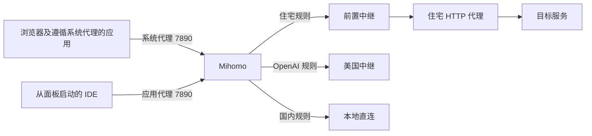

# PureISP 架构与接口

核对日期：2026-10-10。以下以仓库代码及本地验证为依据。

## 三种工程形态

### Node 服务

`server/src/server.js` 使用 Node 内置模块，监听 `0.0.0.0:3600`，可通过 `PORT` 覆盖端口。它直接返回 `public/index.html` 和 `public/console.html`，提供卡密查询、动态订阅、ZIP 下载，以及到本机 `127.0.0.1:9090` 的 `/proxies` 转发。

卡密存在 `licenses.js` 的内存字典中。`getLicense` 只去空格、转大写和查询字典，不验证 active、到期时间或流量。`config-generator.js` 从本机 APPDATA 下 Clash Verge 固定的 `profiles/LC8RvVCmlJoz.yaml` 截取中继节点，再追加住宅节点和固定节点名的代理组。

### Windows B/S 极简客户端

启动器 → `PureISP-Core.exe`（Mihomo）→ 本地控制器及 `ui/index.html`。启动器默认不启动 Node 服务，控制台入口是 `http://127.0.0.1:9090/ui/`。

1.0.4 源码位于 `client/launcher/`。它等待内核就绪，备份原系统代理并通过 WinINet 接入 7890，使普通浏览器使用原有双轨规则。IDE 获得单独的 Chromium 参数和进程环境，不改用户级环境变量。退出先恢复原系统代理，再停止自己的内核；如果其他软件后来修改了代理，不覆盖该修改。原设置包括 flags、代理地址、绕过和 PAC，备份位于 `%LOCALAPPDATA%/PureISP/system-proxy.backup`，异常退出后下次启动可恢复。已有 IDE 须先保存并退出，避免 Electron 复用旧环境。

Mihomo 控制器提供 `/proxies` 等接口，不提供本项目 Node 的 `/api/v1/*`。当前控制台保留了部分业务状态接口请求和演示内容；独立内核模式下这些业务状态尚未接入真实数据。

面板关闭与退出分开：✕/最小化隐藏到托盘，内核和代理保持运行；面板或托盘“停止并退出”才清理。关机查询消息立即允许，确认结束会话后同步恢复系统代理，再停止内核且不等待退出；取消关机不清理。恢复失败保留备份并记日志，下次启动恢复；不提供固定耗时或断电后的绝对保证。

### Clash Verge 集成组件

`PureIspDashboard.tsx` 引用外部工程的组件、hooks 和命令服务。本仓库没有客户端 package.json、构建配置及这些依赖，所以它是集成素材。它通过 `patchVerge` 操作系统代理、通过 `createProfile` 创建订阅；验证与检测失败时会回退到静态展示数据。

旧 `dist/PureISP-Portable/` 使用完整 Clash Verge 程序与独立 data 目录，运行方式与 B/S 版不同。

## 流量链路

现有规则把 Claude / Gemini 和兜底流量送往住宅出口，把 OpenAI 相关域名送往美国中继，把部分国内流量直连。住宅 HTTP 节点通过 `dialer-proxy` 连接前置中继。这是配置策略，不代表所有域名覆盖、出口属性和平台访问结果都已验证。

增强规则使用 prepend / append。原订阅若存在更靠前的 MATCH，append 中的规则可能不被匹配；需检查合并后的最终规则。

## 端口

| 组件 | 当前端口 | 说明 |
| --- | --- | --- |
| Node 服务 | 3600 | 官网及项目 API，代码监听所有网卡 |
| B/S 内核 | 7890 | HTTP / SOCKS mixed-port，发行配置 allow-lan=true |
| B/S 控制器 | 127.0.0.1:9090 | 控制 API 和 UI；现有配置未设 secret |
| 历史 Clash Verge 便携版 | 7897 | 不可当作 B/S 版代理端口 |

## Node 接口

| 方法 | 路径 | 当前行为 |
| --- | --- | --- |
| GET | `/health` | HTTP 进程健康；不检测内核或出口 |
| GET | `/`、`/index.html` | 官网 |
| GET | `/console`、`/dashboard`、`/console.html` | 控制台 |
| GET / HEAD | `/download/<filename>` | 按名称选择 B/S 或完整便携 ZIP |
| POST | `/api/v1/auth/verify` | 查询内置卡密；无效返回 401 |
| GET | `/api/v1/subscription/<license>.yaml` | 生成 YAML；无效卡密返回 404 |
| GET | `/api/v1/proxy/status` | 进程内演示状态及卡密元数据 |
| POST | `/api/v1/proxy/toggle` | 仅切换内存 connected，不操作内核或系统代理 |
| POST | `/api/v1/proxy/ping` | 随机抖动延迟，非真实探测 |
| POST | `/api/v1/license/switch` | 切换全局内存卡密，不重载内核；无效返回 400 |
| GET | `/api/v1/ip/inspect`、`/api/v1/ip/check` | 静态元数据及固定检测结果 |
| 转发 | `/proxies*` | 请求本机 9090；失败时返回演示节点，写操作也会回退 |

验证和切换接收 `{ "licenseKey": "..." }`；toggle 接收 `{ "connected": false }` 或翻转当前状态。

## 实现边界

- 状态及当前卡密在整个 Node 进程中共享，不按用户隔离，重启后重置。
- 验证接口返回的订阅 URL 固定为 `http://127.0.0.1:<PORT>`；远程客户拿到后会指向客户自己的机器。
- 生成器不检查中继完整性。本机缺少基础订阅时中继数为 0，输出仍引用中继名称。
- 节点凭据存在源码、模板和发行配置中，文档不复制凭据。
- 既有页面中的 IP 类型、欺诈分和泄漏检测展示不能作为实时检测证明。
- 内核二进制可以运行；本仓库没有该内核的源码和构建流程。
